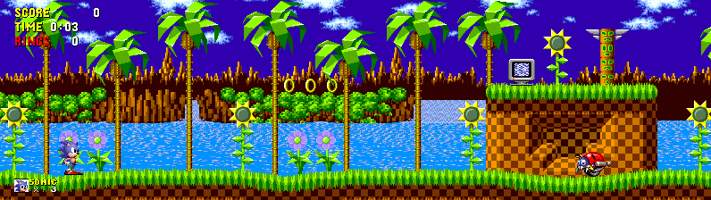
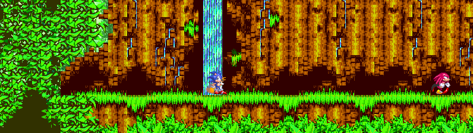
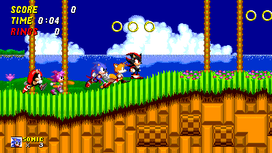

<p align="center">
  
</p>

# Genesis Recomp

**[Windows x64 recompiler tool v0.1.2](https://github.com/mstan/segagenesisrecomp/releases/tag/v0.1.2)**
includes `GenesisRecomp.exe`, its license/notices and usage instructions. Game
runners and their launcher assets are distributed by the title projects below.

**A beta static-recompilation framework for the Sega Genesis / Mega Drive
and Sega CD / Mega-CD.** The cartridge pipeline translates 68000 code into
native C and supplies a shared VDP, audio, bus, scheduler and Z80 runtime,
with an interpreter fallback for unresolved cartridge targets. Each game
owns its input identity and integration.

Sega CD support currently lives on **`feature/segacd-backend`**. Its first
released consumer, **Sonic CD 0.0.1**, runs original Main/Sub 68000 and Z80
programs as native code, with terminal misses and no interpreter fallback.

The Sonic trilogy, Sonic CD and Rocket Knight Adventures show what that enables:
**adaptive ultrawide stages, modern controls, mods, multiplayer, save states
and rewind**, with different feature limits for each game.

**[Choose a game](#games)** · **[Start a cartridge integration](docs/GETTING_STARTED.md)** · **[Set up a Sega CD recomp](docs/SEGA_CD_SETUP.md)**
— command-line tools and source code, with no AI required.

## Games

These public projects use the shared framework. Beta describes the framework;
the widescreen renderers and imported campaigns remain experimental. This
snapshot was checked against public source/release notes on **21 October
2026**, with development-only work labeled separately.

| Game | Project / downloads | Features and scope |
|---|---|---|
| *Sonic the Hedgehog* | [SonicTheHedgehogRecomp](https://github.com/mstan/SonicTheHedgehogRecomp) · [downloads](https://github.com/mstan/SonicTheHedgehogRecomp/releases) | Optional adaptive/16:9/21:9/32:9 stage renderer, expanded objects/HUD, save states and rewind. |
| *Sonic the Hedgehog 2* | [SonicTheHedgehog2Recomp](https://github.com/mstan/SonicTheHedgehog2Recomp) · [downloads](https://github.com/mstan/SonicTheHedgehog2Recomp/releases) | Adaptive ultrawide, character/party mods, rollback netplay and experimental independent online cameras. Version 0.9.0 adds six local/online campaign seats; direct LAN remains two peers. |
| *Sonic CD* | [SonicCDRecomp](https://github.com/mstan/SonicCDRecomp) · [0.0.1 downloads](https://github.com/mstan/SonicCDRecomp/releases/tag/v0.0.1) | Original US CD programs, strict native Main/Sub 68000 and Z80, recomp-ui, adaptive stage widescreen, FM/PSG/PCM/CD audio and backup-RAM saves. Windows/Linux x64; users supply the qualified disc and BIOS. |
| *Sonic 3*, *Sonic & Knuckles*, *Sonic 3 & Knuckles* | [Sonic3AndKnucklesRecomp](https://github.com/mstan/Sonic3AndKnucklesRecomp) · [downloads](https://github.com/mstan/Sonic3AndKnucklesRecomp/releases) | Three cartridge targets, custom adaptive/ultrawide renderer; the combined target adds optional Sonic 1/2/Megamix campaigns and Mighty/Shadow. |
| *Rocket Knight Adventures* | [RocketKnightAdventuresRecomp](https://github.com/mstan/RocketKnightAdventuresRecomp) · [downloads](https://github.com/mstan/RocketKnightAdventuresRecomp/releases) | Adaptive scenery/actors across seven stages, remappable input, visual save browser and rewind. |

### Sonic 1–3 in widescreen

The game-owned renderers expand stage scenery, object visibility and HUD
placement. **Adaptive** follows the live window; fixed 16:9, 21:9 and 32:9
views are also available. They do not establish whole-game correctness at
every width. Enable Widescreen in each game's **Mods** page.

<table>
  <tr><td><br><sub><b>Sonic the Hedgehog</b> — Green Hill at 32:9.</sub></td></tr>
  <tr><td><br><sub><b>Sonic 3 &amp; Knuckles</b> — Angel Island at 32:9.</sub></td></tr>
</table>

### Sonic 2: a party of six

Version 0.9.0 extends party play to **six actors**:
Sonic, Tails, Knuckles, Amy, Mighty and Shadow. Optional imported characters
need the exact source ROMs or converted packs described by the game; no donor
assets are distributed. This screenshot is from the development build used to
validate that work. See the game's release notes for the qualification limits.

<p align="center">
  
  <br><sub><b>Six-character Sonic 2 party.</b> Development validation screenshot for the version 0.9.0 campaign work.</sub>
</p>

### Sonic 3: Sonic 1 + 2 + 3, then Megamix

The combined S3K target offers independent, default-off **Sonic 1 stages**,
**Sonic 2 stages**, **Sonic Megamix stages**, **Mighty** and **Shadow** mods.
Enabled Sonic 1/2 campaigns precede native S3K, with Megamix last. Characters
can be enabled separately from their stage pack. Supply and convert the
required source ROMs locally; Megamix content uses the supported v3 donor.

Progress retains native-compatible SRAM and an addon journal. Imported
campaign state currently excludes quickstates, rewind and netplay. See
[stage-pack setup and credits](https://github.com/mstan/Sonic3AndKnucklesRecomp/blob/main/docs/STAGE_PACKS.md)
and [Megamix gameplay and validation](https://github.com/mstan/Sonic3AndKnucklesRecomp/blob/main/docs/MEGAMIX_STAGE_PACK.md)
for what has actually been exercised.

### Sonic CD: original programs on the Sega CD backend

<p align="center">
  
  <br><sub><b>Sonic CD</b> — Palmtree Panic with adaptive stage widescreen.</sub>
</p>

[Sonic CD 0.0.1](https://github.com/mstan/SonicCDRecomp/releases/tag/v0.0.1)
ships a Windows ZIP and Linux AppImage. Supply your own **US Sonic CD disc**
and **US Model 1 v1.10 Sega CD BIOS**; the launcher remembers their paths.
The game opens windowed with normal audio. F1/Esc opens recomp-ui; supported
normal stages expand with the window, while special stages keep their
original centered projection. Saves use original backup RAM. This release
does not include the cartridge runner's save-state/rewind UI or netplay.

The [validation ledger](https://github.com/mstan/SonicCDRecomp/blob/main/docs/VALIDATION.md)
records 70 stage/time variants, seven boss completions, eight special stages,
ending/credits, save boundaries and independent visual comparisons, with
explicit coverage limits. See [CD setup](docs/SEGA_CD_SETUP.md) for supported
inputs, a source build and the reusable backend's integration boundaries.

### Rocket Knight Adventures: Sparkster across a wider world

<p align="center">
  
  <br><sub><b>Rocket Knight Adventures</b> — adaptive bridge battle.</sub>
</p>

The Widescreen mod offers **Adaptive (fit window)** and fixed views, with a
choice between original and viewport-based enemy activation. The original
view remains available when the mod is off. Stage and boss coverage is
documented by the game project.

Screenshot provenance and version boundaries are recorded in
[the showcase sources](docs/SHOWCASE_SOURCES.md).

## Status

| Feature | Status | Notes |
|---------|--------|-------|
| 68K frontend | Active | Shared decoder, validator, discovery, and emitter from `m68k-recomp-core` |
| Runtime fallback | Cartridge runner | Clean-room Tier-3 interpreter handles supported cartridge static-dispatch misses; Sonic CD's native runner stops on misses |
| Runtime hardware | Active | Own VDP, bus, scheduler, YM2612, SN76489, and Z80 integration |
| Function discovery | Evidence-driven | Static analysis plus disassembly and runtime evidence declared by `game.toml` |
| Validation | Local | Synthetic harnesses, boot/regression scripts, and recomp-vs-interpreter cosim |
| Cartridge Z80 static recompilation | Experimental | Optional cartridge backend; see [docs/Z80_STATIC_RECOMP.md](docs/Z80_STATIC_RECOMP.md) |
| Widescreen injection | Per game | Current status and remaining conversions are in [WIDESCREEN_ISSUES.md](WIDESCREEN_ISSUES.md) |
| Local rewind | Active | rbengine snapshots of the complete machine, with a paused filmstrip and branch trimming |
| Sega CD hardware/runtime | Feature branch | Reusable Main/Sub buses, Word RAM, CDD/CDC/DMA, stamp graphics, PCM/CDDA and backup RAM on `feature/segacd-backend` |
| Sega CD native execution | Released consumer | Sonic CD 0.0.1 executes Main/Sub 68000 and Z80 natively; see [CD setup and scope](docs/SEGA_CD_SETUP.md) |

The save-state and rewind controls below apply to the cartridge runner.
Sonic CD 0.0.1 uses original backup-RAM saves and its own recomp-ui controls.

The in-game save-state browser opens with **F7** or **Back/View + RB**; use
arrows or the D-pad to select a slot, **Enter/A** to load, **S/X** to save,
and **Esc/B** to cancel. **F8** or **Back/View + right-stick click** opens
rewind. In its filmstrip, Left goes back, Right moves toward the present,
Enter/A restores, and Esc/B cancels. The guest and audio pause while either
overlay is open. Save-state files remain `native_save_1.bin` through
`native_save_9.bin`; thumbnail sidecars are optional. Shift+1–9 on the
top row saves directly and 1–9 loads directly.
Both overlays are unavailable during netplay.

The launcher's Rewind settings control whether snapshots are kept, ring
depth, and capture interval. `settings.ini` also accepts `[rewind]` keys
`enabled`, `depth` (4–240 slots), and `interval` (1–60 guest frames).
Defaults are 60 slots every 6 frames, about six seconds at 60 Hz.

## What's In This Repo

| Directory | Purpose |
|-----------|---------|
| `recompiler/` | Genesis-specific CLI, ROM parser, and TOML configuration loader |
| `external/m68k-recomp-core/` | Shared 68000 decoder, validator, discovery, and code-emission profiles |
| `external/z80-recomp-core/` | [Shared Z80 generated-code ABI and verified instruction semantics](https://github.com/mstan/z80-recomp-core) — pinned submodule shared with SMS/GG Recomp |
| `runner/` | Clean-room runtime, debugger, audio, video, input, and netplay integration |
| `tests/` | ROM-independent synthetic harnesses plus optional ROM-backed decoder fixtures |
| `sonicthehedgehog/`, `puyo/`, `rka/` | Legacy game implementations awaiting separate ownership migrations; not a pattern for new work |
| `<game build>/generated/<prefix>/` | Ignored output regenerated from the ROM, config, and current recompiler |

Game-specific adapters, ROM addresses/layouts, mods, campaign formats, assets,
disassembly pins and game tests belong in the consuming game repository.
Sonic 2 now owns these under `SonicTheHedgehog2Recomp/game/`, `tests/`, `tools/`
and `docs/`; the Sonic 3 family owns them under `Sonic3AndKnucklesRecomp/game/`
(`common/`, `sonic3/`, `sonic3k/`, `sandk/`, pinned `skdisasm/`), `tests/`,
`tools/`, `ghidra/` and `docs/`. The shared engine provides reusable opt-in interfaces only.
`genesisrecomp_add_generated_sources` accepts an absolute caller-owned game
directory; legacy engine-relative paths remain supported for other consumers.

## How It Works

### Cartridge games

The Genesis CLI loads a ROM and `game.toml`, then invokes the Genesis profile in
`m68k-recomp-core`. Discovered 68K routines become C functions operating on the
shared `M68KState` and runtime bus. Generated dispatch code falls back to the
clean-room interpreter for supported dynamic targets that were not statically
materialized.

Key recompiler features:
- **`addq.l #4,sp` early-exit detection**: Pre-scans each function for stack pointer adjustments. Emits local `_sp_popped` counter so `rts` propagates returns through the caller's post-JSR check via `g_rte_pending`.
- **Dispatch table accessor generation**: `game_dispatch_table_size()` and `game_dispatch_table_addr()` enable runtime interior label detection.
- **Per-instruction cycle estimation**: Emitted costs come from the clean-room
  MC68000 timing model in the shared Genesis profile, so generation has no
  emulator dependency.

### Sega CD games

The CD pipeline generates native catalogs for the original BIOS, Main/Sub
program loads and Z80 code variants. Instruction-byte guards distinguish
overlays and modified code at the same address. The native machine runs
those programs against coordinated CPU/device clocks, Word RAM ownership,
raw-sector/CD audio delivery and backup RAM. Missing executed variants stop
the native runner; separately named diagnostic probes support offline
discovery. The consuming game owns its supported inputs, program recipe,
presentation and packaging. See [CD setup](docs/SEGA_CD_SETUP.md).

## Cloning

```bash
git clone --recursive https://github.com/mstan/segagenesisrecomp.git
```

The recursive clone checks out the shared 68000, Z80, netplay, and Sonic
disassembly submodules. See [DISASSEMBLIES.md](docs/DISASSEMBLIES.md) for
ROM-verified annotation regeneration and headless Ghidra imports.
There is no emulator-core or AGPL dependency in the repository.

For Sega CD, use the [CD setup guide](docs/SEGA_CD_SETUP.md). It selects the
backend branch and the two required CPU submodules, or the released game's
pinned engine and Z80 generation frontend. The Genesis CLI and `game.toml`
workflow above describe cartridge integration.

## Platform Support

The cartridge runner builds and runs natively on **Windows (MSVC)**, **macOS (Apple
Silicon & Intel)**, and **Linux**. The cooperative game-fiber scheduler is
backed by Win32 Fibers on Windows and by `ucontext` on macOS/Linux via
`runner/fiber_compat.{h,c}`; SDL2 handles windowing, rendering, audio, and
`SDL_GameController` gamepads on all platforms. See the
[SonicTheHedgehogRecomp](https://github.com/mstan/SonicTheHedgehogRecomp)
README for per-platform build steps.

Sonic CD 0.0.1 is qualified on **Windows x64** and **Linux x86_64**. Its Linux
AppImage requires glibc 2.39+ (Ubuntu 24.04 baseline) and Python 3. CD macOS
builds and other BIOS/disc revisions are not qualified by that release.

## Building the Recompiler

The recompiler is C11 and builds with CMake and a C toolchain.

```bash
cd recompiler

# Windows (MSVC)
cmake -S . -B build -G "Visual Studio 17 2022" -A x64
cmake --build build --config Release

# macOS / Linux (Ninja)
cmake -S . -B build -G Ninja -DCMAKE_BUILD_TYPE=Release
ninja -C build
```

## Running Framework Tests

The ROM-independent harnesses can be configured directly:

```bash
cmake -S tests -B build/tests
cmake --build build/tests --config Release
ctest --test-dir build/tests -C Release --output-on-failure
```

`l1_decoder_test` is built but not registered with CTest because it requires a
user-supplied Sonic ROM. Its `--help` output documents the fixture and ROM
arguments.

## Regenerating Output

```bash
cd sonicthehedgehog
../recompiler/build/Release/GenesisRecomp.exe sonic.bin --game game.toml --output-dir generated
```

The manual command writes ignored files under `generated/`. Normal game CMake
builds isolate them under that build tree's `generated/<prefix>/` directory
and rebuild whenever the ROM, game config, discovery inputs, annotations,
recompiler, or generation options change. Generated C is deliberately not
tracked in Git.

## Building and Running the Game

See **[SonicTheHedgehogRecomp](https://github.com/mstan/SonicTheHedgehogRecomp)** for build instructions, controls, and known issues.

## Audio & Video Enhancements (opt-in)

The runner ships an optional **verified-enhancement shadow** layer: quality-of-life
audio/video improvements that run *alongside* the authentic hardware emulation
without ever replacing it as ground truth. The governing rule (see
[`docs/SHADOW_ENHANCEMENTS.md`](docs/SHADOW_ENHANCEMENTS.md)):

- The authentic (canon) path stays the authoritative output **and** the verify
  oracle — the shadow is never ground truth.
- The shadow is continuously diff-checked against canon and substitutes **only
  after a proven correlation window**.
- It **reverts loudly** (logs `[AUDIO-SHADOW] DEGRADED …`) the instant it stops
  matching.
- It is **off by default**. With it off, output is byte-identical to the raw
  hardware emulation (the `[FBHASH]` framebuffer hash, PNG dumps, and WAV capture
  all stay on the raw canon). Worst case when on is "you see/hear authentic
  hardware output," and it cannot mask a recompiler bug because the canon path it
  shadows is still the thing being diffed.

All options are environment variables, default OFF:

| Variable | Values | Effect |
|----------|--------|--------|
| `GENESIS_SCREEN` | `raw` (default), `crt`, `trinitron`, `composite`, `linear` | Present-time color model. `raw` reproduces the existing 9-bit→ARGB8888 expansion bit-identically. The others map the Genesis 9-bit (BGR 3-3-3) gamut through a CIE color core (panel primaries → sRGB via Bradford + sRGB OETF): `crt` = generic SMPTE-C phosphor + γ≈2.4 + lifted black, `trinitron` = Sony P22-ish primaries, `composite` = gentler γ + higher black floor, `linear` = clean linear-light reference. Per-pixel color only — it does **not** synthesize composite/RF spatial artifacts (dot crawl, cross-color, NTSC blur). |
| `GENESIS_AUDIO_SHADOW` | `0` (default) / `1` | Arms the YM2612 FM shadow. A second `ymfm` chip is fed the identical register-write stream as the canon chip but rendered with a **relaxed output low-pass** (near-passthrough) instead of the aggressive filter canon uses to match the reference — preserving the cleaner, less-aliased high end. Gain is identical; the verifier substitutes the FM stereo samples only once proven. The SN76489 (PSG) path is untouched. |
| `GENESIS_FM_LADDER` | unset (default) / `off` | When `off`, the FM shadow renders through ymfm's **`ym3438`** chip — the same FM engine without the YM2612's DAC "ladder" discontinuity (the ~7-LSB crossover gap around zero, i.e. the audible low-level crunch). This is the later CMOS Genesis FM revision that fixed it; no hand-rolled correction curve. Requires `GENESIS_AUDIO_SHADOW=1`. Verifier-policed like any other enhancement. |

Example (all on):

```bash
GENESIS_AUDIO_SHADOW=1 GENESIS_FM_LADDER=off GENESIS_SCREEN=crt \
    ./Sonic3KRecomp sonic3k.bin
```

These are present-time/runtime only and link no clownmdemu — they are part of
the AGPL-free native runtime and safe to ship. To wire them into a game build,
add `runner/audio/audio_shadow.c`, `runner/audio/fm_shadow.cpp`, and
`runner/video/color_lut.c` to that game's source list (the `video/` and
`external/ymfm/src` include dirs are already present). See
[`docs/SHADOW_ENHANCEMENTS.md`](docs/SHADOW_ENHANCEMENTS.md) for the full design,
verifier algorithm, and integration points.

### Widescreen integration

Current public games expose game-owned widescreen mods with adaptive and
fixed aspect choices. The old `GENESIS_WIDESCREEN` column-expansion path is
a development interface, not a description of every current renderer.
Each game owns its streaming, visibility, camera and HUD policies; menus
and special screens can use different presentation rules.

See the [game list](#games) and per-title renderer guides for current
behavior. [WIDESCREEN_ISSUES.md](WIDESCREEN_ISSUES.md) retains the migration
history and older injection work. The shared plane-batching experiment is
documented separately in [ENGINE_VDP_BATCHING.md](docs/ENGINE_VDP_BATCHING.md).

#### Disassembly sources

The optional widescreen builds are produced from these community Sega Genesis
disassemblies (build-time sources only — the shipped binaries are recompiled C,
and the 4:3 path reassembles byte-identically to the canonical ROMs):

- **Sonic the Hedgehog** — [Sonic Retro `s1disasm`](https://github.com/sonicretro/s1disasm)
- **Sonic the Hedgehog 2** — [Sonic Retro `s2disasm`](https://github.com/sonicretro/s2disasm)
- **Sonic 3 & Knuckles** — [Sonic Retro `skdisasm`](https://github.com/sonicretro/skdisasm)

With thanks to the Sonic Retro community for maintaining these disassemblies.

## Key Files

| File | Purpose |
|------|---------|
| `external/m68k-recomp-core/profiles/genesis/code_generator.c` | Genesis 68K → C emitter and timing profile |
| `external/m68k-recomp-core/common/m68k_decoder.c` | Shared 68K instruction decoder |
| `recompiler/src/game_config.c` | Genesis `game.toml` loader and validation |
| `runner/include/genesis_runtime.h` | Shared interface: `M68KState`, `g_rte_pending`, `g_early_return`, bus access |
| `<game build>/generated/<prefix>/*_partNN.c` | Ignored build output containing generated functions |
| `<game build>/generated/<prefix>/*_dispatch.c` | Ignored build output containing the dispatch table |
| `sonicthehedgehog/game.toml` | Sonic 1 configuration, evidence inputs, and optional transforms |

## License

[PolyForm Noncommercial 1.0.0](LICENSE.md) — free for non-commercial use.
Third-party notices are collected in
[THIRD-PARTY-LICENSES.md](THIRD-PARTY-LICENSES.md).

---

<p align="center">
  <sub><b>R.A.I.D. — Retro AI Development</b> · a Discord for AI-assisted retro reverse-engineering, decomp &amp; recomp</sub>
</p>

<p align="center">
  <a href="https://discord.gg/Ad9BwSzctP"></a>
</p>
